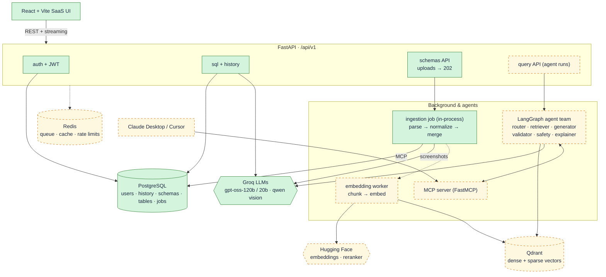
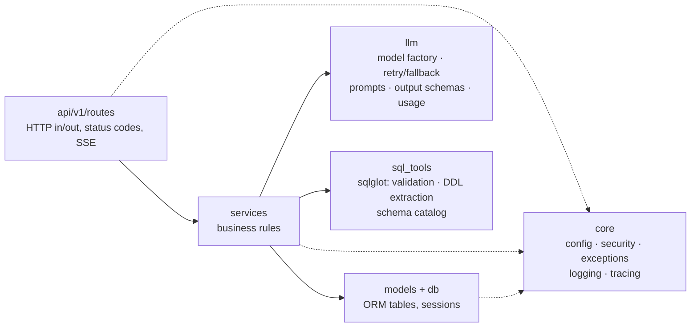
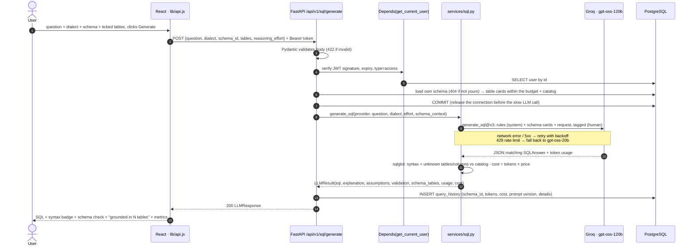
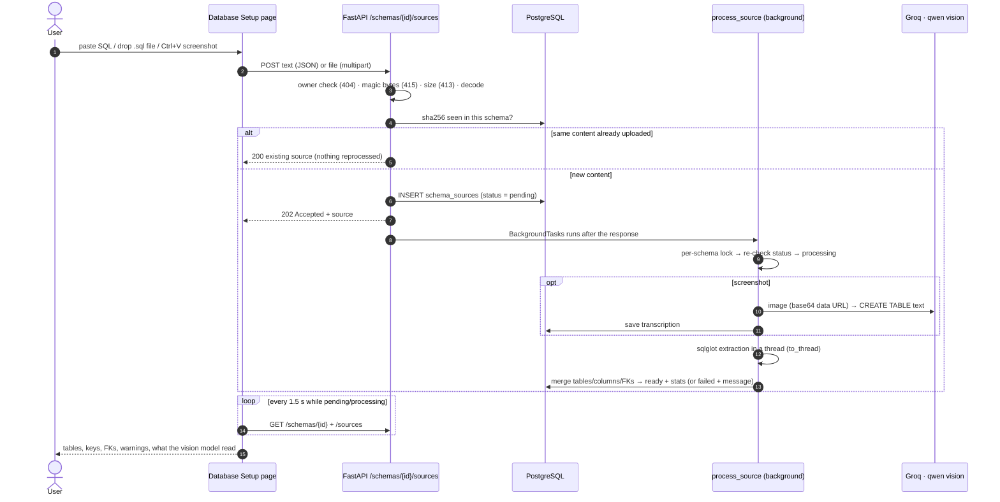
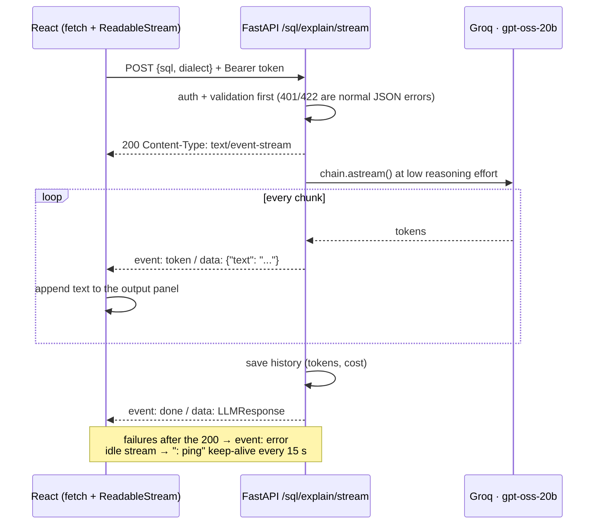
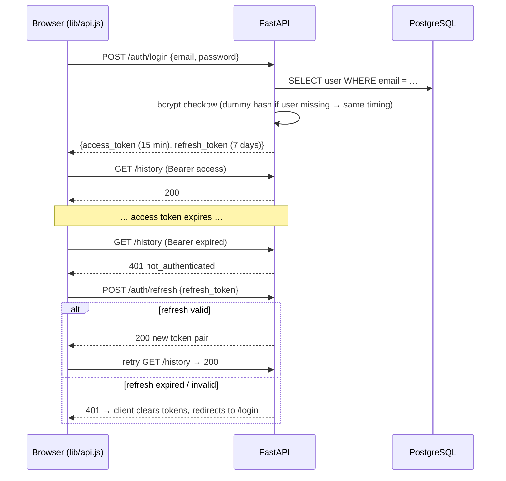
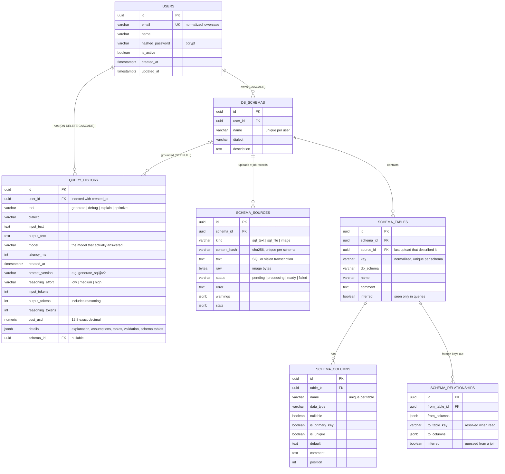
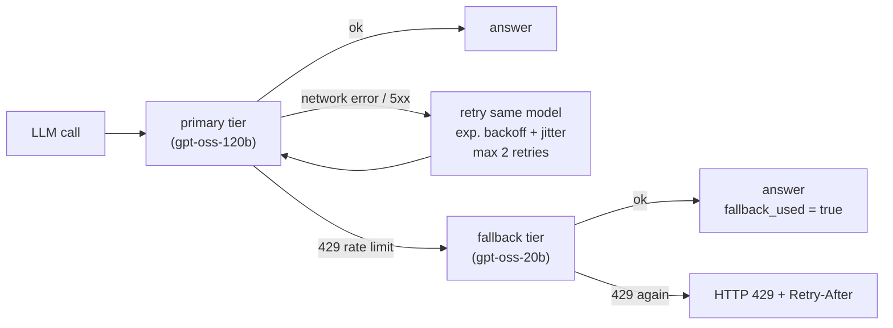
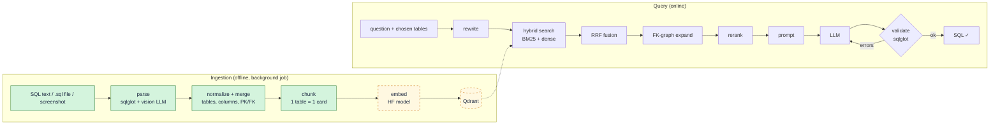
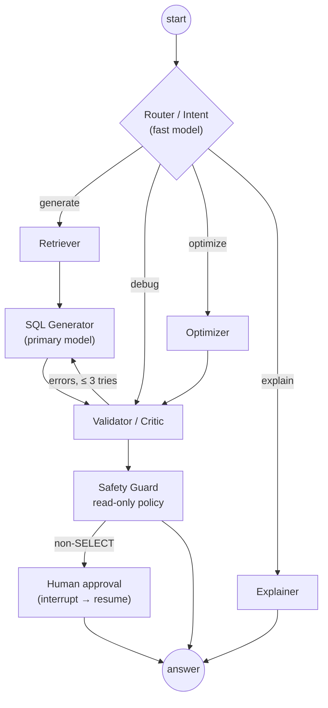

# SQLAssist: AI-powered SQL Assistant

> Ask questions in plain English, get correct SQL for **your** database.
> A learning-in-public project that grows into a full SaaS with **schema-aware RAG**, a **LangGraph agent team**, **RAG evaluation** and an **MCP server**.

| | |
|---|---|
| **Backend** | FastAPI (async) · SQLAlchemy 2 + asyncpg · Alembic · PostgreSQL |
| **AI** | LangChain + LangGraph · Groq (`openai/gpt-oss-120b`, `gpt-oss-20b`) · Hugging Face embeddings · Qdrant |
| **Frontend** | React 19 · Vite · Tailwind · Framer Motion |
| **Ops** | uv · Docker Compose · GitHub Actions (planned) |
| **Learning notes** | 📓 [SQLAssist Notebook (PDF)](docs/notebook/SQLAssist-Notebook.pdf): hand-drawn explanations of every concept used here |

---

## Project status

| Phase | Scope | Status |
|---|---|---|
| 0 | Foundation: Postgres, auth, LangChain LLM layer, bug fixes | ✅ done |
| 1 | LLM layer: structured output, SQL validation, SSE streaming, tokens & cost, reasoning effort, retries & fallbacks, prompt versions, LangSmith tracing | ✅ done |
| 2 | Schema ingestion: SQL text / `.sql` files / screenshots (vision LLM) → normalized schema, background jobs, grounded prompts, schema-aware validation, table picker | ✅ done |
| 3 | Embeddings + Qdrant: table cards, dense + sparse vectors, multi-tenancy | ⏭️ next |
| 4 | Retrieval: BM25, dense, hybrid (RRF), FK-graph expansion, reranking | planned |
| 5 | RAG evaluation: golden set, retrieval metrics, execution accuracy, RAGAS, CI gate | planned |
| 6 | Agents (LangGraph): router, retriever, generator, validator, safety, optimizer, explainer, memory, HITL | planned |
| 7 | MCP server (FastMCP) exposing SQLAssist tools to Claude Desktop / Cursor | planned |
| 8 | SaaS & scale: workspaces, rate limits, caching, observability, UI/UX polish | planned |
| 9 | Ship: Dockerfiles, CI/CD, deployment | planned |

The full plan, with decisions and learning goals per phase, is in [docs/ROADMAP.md](docs/ROADMAP.md).
File-by-file explanations of each phase: [Phase 0: foundation](docs/phases/phase-0-foundation.md) · [Phase 1: LLM layer](docs/phases/phase-1-llm-layer.md) · [Phase 2: schema ingestion](docs/phases/phase-2-schema-ingestion.md).

---

## Architecture

### Target system (green = built, dashed = coming)



### Backend layers



Lower layers never import upper ones. `services/` knows nothing about HTTP, so the same functions will later be called by LangGraph agents (Phase 6) and MCP tools (Phase 7).

### What happens when you click “Generate SQL”



### Uploading a schema (Phase 2): 202 + background job + polling



A failed upload can simply be sent again (the same content is retried). Jobs interrupted by a server restart are marked failed at startup, so the page never polls forever.

### Streaming an explanation (Server-Sent Events)



### Authentication: access + refresh tokens



Concurrent 401s share **one** refresh request (single-flight), see `frontend/src/lib/api.js`.

### Data model



A relationship points at its target by **key**, not by a database foreign key: uploads arrive in any order, so `order_items → products` can be stored before `products` exists.

### LLM resilience policy



The Groq SDK's own retries are switched off (`max_retries=0`). By default it would sleep for the server's `Retry-After`, up to 60 s on every attempt, before our fallback could react.

### The RAG pipeline (ingestion built in Phase 2; retrieval in Phases 3–4)



Today (Phase 2) the "retrieval" step is the user's table selection, or every table up to a character budget (`SCHEMA_CONTEXT_MAX_CHARS`); the answer reports when tables were left out. Phases 3–4 replace that with relevance-ranked retrieval, measured against this baseline in Phase 5.

### Coming next: the agent graph (Phase 6)



---

## Getting started

### Prerequisites
- Python 3.12 via [uv](https://docs.astral.sh/uv/) · Node 20+ · PostgreSQL 15+ (local install **or** Docker)
- A free Groq API key: <https://console.groq.com/keys>

### 1. Database: pick one

**Option A: a local PostgreSQL (managed with pgAdmin).** In pgAdmin, right-click your server → **Query Tool**, then run these statements **one at a time** (select a line, press F5). `CREATE DATABASE` refuses to run together with other statements.

```sql
CREATE ROLE sqlassist WITH LOGIN PASSWORD 'choose-a-strong-password';
```

```sql
CREATE DATABASE sql_assistant OWNER sqlassist;
```

A dedicated role is least privilege: the app owns its own database and nothing else, unlike the `postgres` superuser. For quick local experiments you can skip the role, create only the database, and use `postgres` plus your install password.

**Option B: Docker.**

```bash
docker compose up -d
```

This starts PostgreSQL on port **5433** (user `postgres`, password `postgres`, database `sql_assistant`) and Qdrant on 6333.

### 2. Backend

```bash
cd backend
cp .env.example .env
```

Edit `backend/.env`:

| Variable | Option A (local) | Option B (Docker) |
|---|---|---|
| `POSTGRES_HOST` | `localhost` | `localhost` |
| `POSTGRES_PORT` | `5432` | `5433` |
| `POSTGRES_USER` | `sqlassist` (or `postgres`) | `postgres` |
| `POSTGRES_PASSWORD` | the password from step 1 | `postgres` |
| `POSTGRES_DB` | `sql_assistant` | `sql_assistant` |

Also set `GROQ_API_KEY` and `JWT_SECRET_KEY` (32+ random characters). Special characters in the password need no escaping: the URL is built with SQLAlchemy's `URL.create()`. Hosted platforms that hand you one connection string can set `DATABASE_URL` instead; it takes precedence. Then:

```bash
uv sync
uv run alembic upgrade head
uv run uvicorn app.main:app --reload --reload-include .env --port 8000
```

`alembic upgrade head` creates the tables. In pgAdmin you should then see `users`, `query_history`, `db_schemas`, `schema_sources`, `schema_tables`, `schema_columns`, `schema_relationships` and `alembic_version` under **sql_assistant → Schemas → public → Tables** (refresh the tree first).

On startup the API logs `Database ready: postgresql+asyncpg://…` or explains what's wrong. You can also check <http://localhost:8000/api/v1/health/ready> (`"database": "up"`). Settings are read once at startup; `--reload-include .env` makes the dev server restart when you edit `.env`, not only when `.py` files change.

Interactive API docs: <http://localhost:8000/docs>

### Optional: LangSmith tracing

To inspect every LLM call (prompt, answer, tokens, latency, retries and fallbacks):
1. Create a free account at <https://smith.langchain.com>.
2. Go to **Settings → API Keys** and create a key.
3. In `backend/.env`, set `LANGSMITH_TRACING=true` and `LANGSMITH_API_KEY=<your key>`.

The dev server restarts by itself and logs `LangSmith tracing is on: project 'sqlassist-dev'`. Each run is tagged with its prompt version and reasoning effort, and carries the user id as metadata. While tracing is on, prompts and answers are stored in LangSmith's cloud.

### Troubleshooting the database connection

| Message (server log or API error) | Cause | Fix |
|---|---|---|
| `password authentication failed for user "…"` | wrong `POSTGRES_USER` / `POSTGRES_PASSWORD`, or the server still runs with an older `.env` | fix `backend/.env`, then restart the API |
| `database "sql_assistant" does not exist` | database not created yet | step 1 above (pgAdmin Query Tool or Docker) |
| `connected …, but it has no tables yet` / `relation "users" does not exist` | migrations not applied | `uv run alembic upgrade head` |
| `Connect call failed` / connection refused | PostgreSQL not running, or wrong host/port | start the PostgreSQL service (Windows: Services → postgresql-x64-17) or check `POSTGRES_PORT` |
| API returns `503 database_unavailable` | any of the above | read the API's startup log line for the exact reason |

### 3. Frontend

```bash
cd frontend
npm install
npm run dev
```

Open <http://localhost:5173>. To run both apps together from the repo root, use `npm install` then `npm run dev`.

### Tests & checks

```bash
cd backend
uv run pytest
uv run ruff check app tests
```

Tests use in-memory SQLite and a fake LLM provider (which can simulate structured answers, streaming, a vision model, rate limits and outages), so they need no database, network or API key. Background ingestion jobs run against the same in-memory database.

---

## API (v1)

| Method | Path | Auth | Purpose |
|---|---|---|---|
| GET | `/api/v1/health/live` · `/health/ready` | – | liveness · readiness (DB check) |
| POST | `/api/v1/auth/signup` | – | create account → `201` |
| POST | `/api/v1/auth/login` | – | email + password → token pair |
| POST | `/api/v1/auth/refresh` | refresh token | new token pair |
| GET / PATCH / DELETE | `/api/v1/users/me` | ✓ | read / rename / delete own account |
| POST | `/api/v1/users/me/password` | ✓ | change password |
| POST | `/api/v1/sql/generate` | ✓ | natural language → validated SQL (structured output) |
| POST | `/api/v1/sql/assist` | ✓ | `mode`: `debug` · `optimize` (structured) · `explain` (text) |
| POST | `/api/v1/sql/explain/stream` | ✓ | explanation streamed as Server-Sent Events: `token`… then `done` or `error` |
| GET | `/api/v1/history?limit&offset` | ✓ | own history, newest first, with tokens, cost and details |
| DELETE | `/api/v1/history/{id}` | ✓ | delete own entry (`404` if not yours) |
| GET / POST | `/api/v1/schemas` | ✓ | list own schemas (status, counts) · create one (`409` on a duplicate name) |
| GET / PATCH / DELETE | `/api/v1/schemas/{id}` | ✓ | tables with columns and FKs · rename / change dialect · delete everything |
| DELETE | `/api/v1/schemas/{id}/tables/{table_id}` | ✓ | remove one table |
| POST | `/api/v1/schemas/{id}/sources/text` | ✓ | `{"sql": "…"}` → `202` + source (`200` if this exact content was already uploaded) |
| POST | `/api/v1/schemas/{id}/sources/file` | ✓ | multipart `file`: `.sql`/`.ddl`/`.txt` or PNG/JPEG/WebP → `202` (`413` too large, `415` other types) |
| GET | `/api/v1/schemas/{id}/sources` · `/sources/{source_id}` | ✓ | uploads, newest first · poll one until `ready` or `failed` |

All three SQL endpoints accept an optional `reasoning_effort` (`low` · `medium` · `high`), and an optional `schema_id` plus `tables` (names to focus on; omitted = the whole schema up to the prompt budget). Every answer (`LLMResponse`) contains:
- `output`, `explanation`, `assumptions`, `tables_used`;
- `validation` (`valid`, `dialect`, `statement_types`, `errors`, plus `schema_checked` and `schema_issues` such as `Unknown column: o.order_date`);
- `schema_id`, `schema_tables` (what the model was shown), `schema_truncated`;
- `model`, `prompt_version`, `reasoning_effort`, `latency_ms`;
- `usage` (input, output, reasoning and cached tokens), `cost_usd`, `fallback_used`, `history_id`.

Every error uses one envelope with a matching HTTP status. A `429 rate_limited` also carries a `Retry-After` header.

```json
{ "error": { "code": "validation_error", "message": "Request validation failed.", "details": [ { "field": "password", "message": "..." } ] } }
```

---

## Repository layout

```
backend/
  app/
    main.py               app factory: CORS, error handlers, routers, lifespan (tracing, DB check)
    core/                 config (pydantic-settings), security (bcrypt, JWT), exceptions, logging,
                          tracing (LangSmith)
    db/                   declarative Base + mixins, async engine/session, release_connection
    models/               User, QueryHistory, DbSchema, SchemaSource, SchemaTable, SchemaColumn,
                          SchemaRelationship (SQLAlchemy 2 typed ORM)
    schemas/              Pydantic request/response models (API contracts)
    services/             auth, sql (structured + streamed LLM calls), history,
                          schemas (CRUD, uploads, merge rules, prompt context), ingestion (background job)
    llm/                  client (ChatGroq tiers, retry/fallback, vision model), prompts (versioned,
                          schema slots), vision (screenshot → DDL), output_schemas, usage (tokens, cost)
    sql_tools/            sqlglot: validation (syntax + unknown tables/columns), ddl (schema
                          extraction), catalog (name normalization)
    api/deps.py           shared dependencies: DbSession, SessionFactory, CurrentUser, LLM (provider)
    api/v1/routes/        auth, users, sql (incl. SSE stream), history, schemas, health
  alembic/                migrations (env.py uses the app's DB settings)
  tests/                  pytest: SQLite in-memory + fake LLM provider (no network)
  pyproject.toml, uv.lock, requirements.txt (exported for pip users)
frontend/
  src/lib/api.js          the only module that talks to the backend (tokens, refresh, errors, SSE, uploads)
  src/lib/                dialects (one list for every dropdown), format helpers
  src/components/         ProtectedRoute, ReasoningEffortSelect, LLMResultDetails
  src/*.jsx               pages (DatabaseSetup = schema workspace, queryBuilder = table picker + generate)
docs/
  ROADMAP.md              phases, decisions, learning goals
  phases/                 per-phase deep dives (what changed, why, how it works)
  notebook/               hand-drawn study notebook (HTML source → PDF via build.mjs)
docker-compose.yml        PostgreSQL + Qdrant for local development
```

## The learning notebook

[`docs/notebook/SQLAssist-Notebook.pdf`](docs/notebook/SQLAssist-Notebook.pdf) is a hand-written-style, diagram-first explanation of every concept in this project: HTTP, async, ORMs, JWT, LLMs, LangChain, RAG, embeddings, Qdrant/HNSW, BM25/hybrid/RRF, reranking, RAG evaluation metrics, agents, LangGraph, memory, human-in-the-loop, MCP, guardrails, Docker and scaling. It grows with every phase. To rebuild it (needs Chrome or Edge and internet for fonts):

```bash
node docs/notebook/build.mjs
```

Add `--check` to find pages that overflow, or `--png 3,12` to preview single pages.
