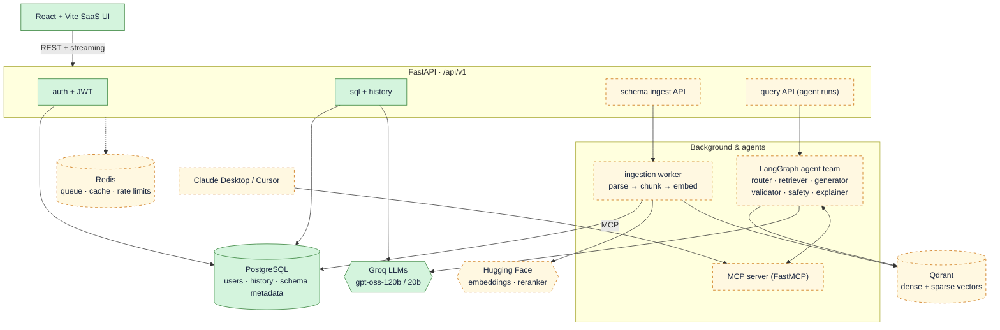
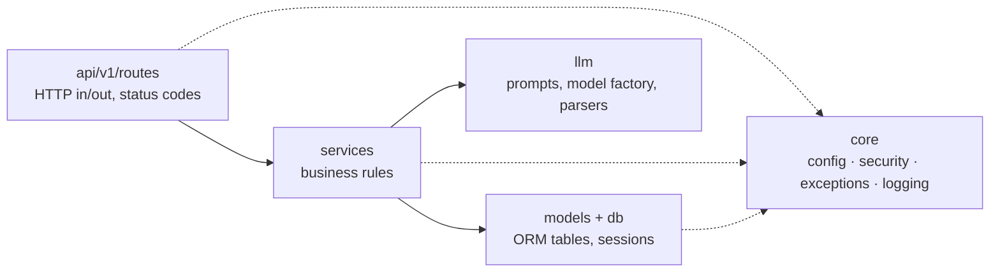
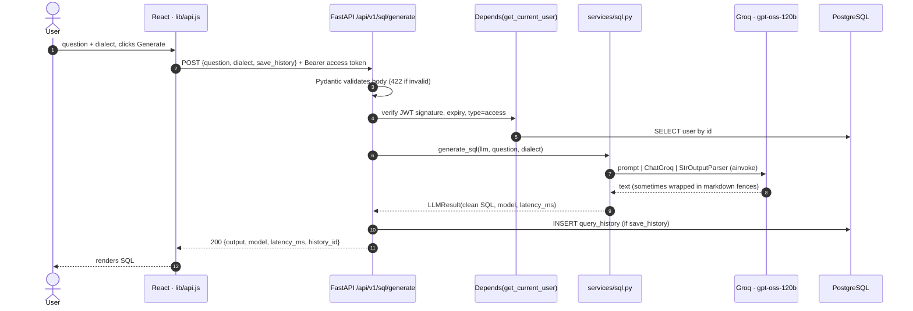
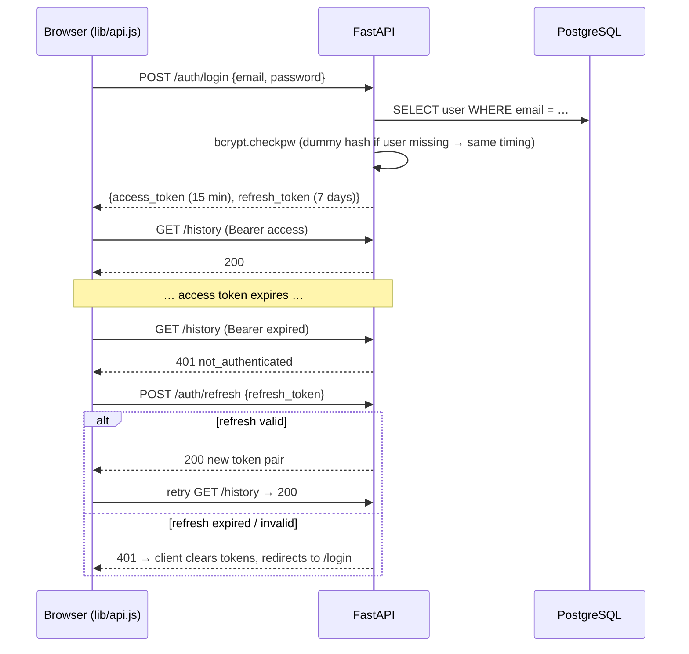
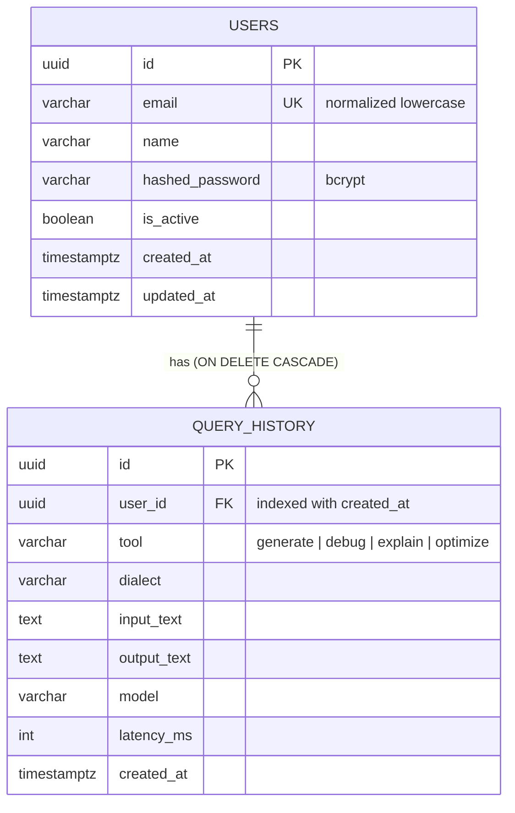
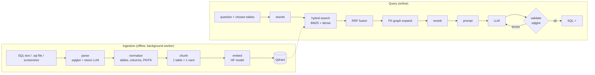
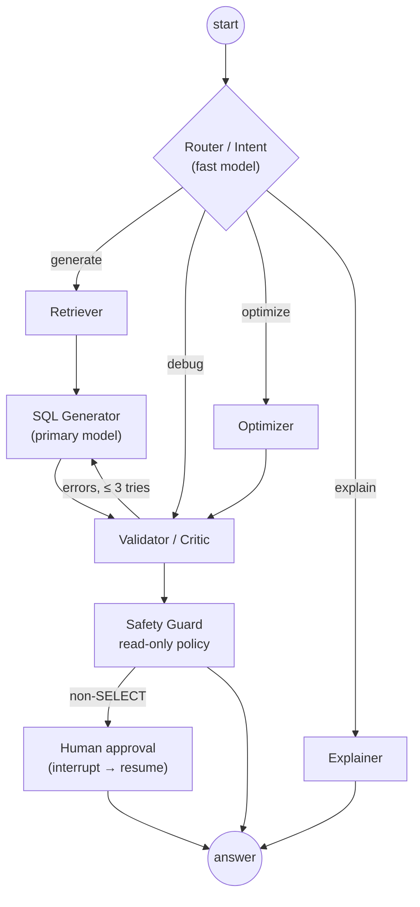

# SQLAssist: AI-powered SQL Assistant

> Ask questions in plain English, get correct SQL for **your** database.
> A learning-in-public project that grows into a full SaaS with **schema-aware RAG**, a **LangGraph agent team**, **RAG evaluation** and an **MCP server**.

| | |
|---|---|
| **Backend** | FastAPI (async) · SQLAlchemy 2 + asyncpg · Alembic · PostgreSQL |
| **AI** | LangChain + LangGraph · Groq (`openai/gpt-oss-120b`, `gpt-oss-20b`) · Hugging Face embeddings · Qdrant |
| **Frontend** | React 19 · Vite · Tailwind · Framer Motion |
| **Ops** | uv · Docker Compose · GitHub Actions (planned) |
| **Learning notes** | 📓 [SQLAssist Notebook (PDF)](docs/notebook/SQLAssist-Notebook.pdf): hand-drawn explanations of every concept used here |

---

## Project status

| Phase | Scope | Status |
|---|---|---|
| 0 | Foundation: Postgres, auth, LangChain LLM layer, bug fixes | ✅ done |
| 1 | LLM layer: structured outputs, streaming, token/cost tracking, tracing | ⏭️ next |
| 2 | Schema ingestion: SQL text / `.sql` files / screenshots → normalized schema | planned |
| 3 | Embeddings + Qdrant: table cards, dense + sparse vectors, multi-tenancy | planned |
| 4 | Retrieval: BM25, dense, hybrid (RRF), FK-graph expansion, reranking | planned |
| 5 | RAG evaluation: golden set, retrieval metrics, execution accuracy, RAGAS, CI gate | planned |
| 6 | Agents (LangGraph): router, retriever, generator, validator, safety, optimizer, explainer, memory, HITL | planned |
| 7 | MCP server (FastMCP) exposing SQLAssist tools to Claude Desktop / Cursor | planned |
| 8 | SaaS & scale: workspaces, rate limits, caching, observability, UI/UX polish | planned |
| 9 | Ship: Dockerfiles, CI/CD, deployment | planned |

The full plan, with decisions and learning goals per phase, is in [docs/ROADMAP.md](docs/ROADMAP.md).
A line-by-line explanation of the Phase 0 code is in [docs/phases/phase-0-foundation.md](docs/phases/phase-0-foundation.md).

---

## Architecture

### Target system (green = built, dashed = coming)



### Backend layers (Phase 0)



Lower layers never import upper ones. `services/` knows nothing about HTTP, so the same functions will later be called by LangGraph agents (Phase 6) and MCP tools (Phase 7).

### What happens when you click “Generate SQL”



### Authentication: access + refresh tokens



Concurrent 401s share **one** refresh request (single-flight), see `frontend/src/lib/api.js`.

### Data model



### Coming next: the RAG pipeline (Phases 2–4)



### Coming next: the agent graph (Phase 6)



---

## Getting started

### Prerequisites
- Python 3.12 via [uv](https://docs.astral.sh/uv/) · Node 20+ · PostgreSQL 15+ (local install **or** Docker)
- A free Groq API key: <https://console.groq.com/keys>

### 1. Database: pick one

**Option A: a local PostgreSQL (managed with pgAdmin).** In pgAdmin, right-click your server → **Query Tool**, then run these statements **one at a time** (select a line, press F5). `CREATE DATABASE` refuses to run together with other statements.

```sql
CREATE ROLE sqlassist WITH LOGIN PASSWORD 'choose-a-strong-password';
```

```sql
CREATE DATABASE sql_assistant OWNER sqlassist;
```

A dedicated role is least privilege: the app owns its own database and nothing else, unlike the `postgres` superuser. For quick local experiments you can skip the role, create only the database, and use `postgres` plus your install password.

**Option B: Docker.**

```bash
docker compose up -d
```

This starts PostgreSQL on port **5433** (user `postgres`, password `postgres`, database `sql_assistant`) and Qdrant on 6333.

### 2. Backend

```bash
cd backend
cp .env.example .env
```

Edit `backend/.env`:

| Variable | Option A (local) | Option B (Docker) |
|---|---|---|
| `POSTGRES_HOST` | `localhost` | `localhost` |
| `POSTGRES_PORT` | `5432` | `5433` |
| `POSTGRES_USER` | `sqlassist` (or `postgres`) | `postgres` |
| `POSTGRES_PASSWORD` | the password from step 1 | `postgres` |
| `POSTGRES_DB` | `sql_assistant` | `sql_assistant` |

Also set `GROQ_API_KEY` and `JWT_SECRET_KEY` (32+ random characters). Special characters in the password need no escaping: the URL is built with SQLAlchemy's `URL.create()`. Hosted platforms that hand you one connection string can set `DATABASE_URL` instead; it takes precedence. Then:

```bash
uv sync
uv run alembic upgrade head
uv run uvicorn app.main:app --reload --reload-include .env --port 8000
```

`alembic upgrade head` creates the tables. In pgAdmin you should then see `users`, `query_history` and `alembic_version` under **sql_assistant → Schemas → public → Tables** (refresh the tree first).

On startup the API logs `Database ready: postgresql+asyncpg://…` or explains what's wrong. You can also check <http://localhost:8000/api/v1/health/ready> (`"database": "up"`). Settings are read once at startup; `--reload-include .env` makes the dev server restart when you edit `.env`, not only when `.py` files change.

Interactive API docs: <http://localhost:8000/docs>

### Troubleshooting the database connection

| Message (server log or API error) | Cause | Fix |
|---|---|---|
| `password authentication failed for user "…"` | wrong `POSTGRES_USER` / `POSTGRES_PASSWORD`, or the server still runs with an older `.env` | fix `backend/.env`, then restart the API |
| `database "sql_assistant" does not exist` | database not created yet | step 1 above (pgAdmin Query Tool or Docker) |
| `connected …, but it has no tables yet` / `relation "users" does not exist` | migrations not applied | `uv run alembic upgrade head` |
| `Connect call failed` / connection refused | PostgreSQL not running, or wrong host/port | start the PostgreSQL service (Windows: Services → postgresql-x64-17) or check `POSTGRES_PORT` |
| API returns `503 database_unavailable` | any of the above | read the API's startup log line for the exact reason |

### 3. Frontend

```bash
cd frontend
npm install
npm run dev
```

Open <http://localhost:5173>. To run both apps together from the repo root, use `npm install` then `npm run dev`.

### Tests & checks

```bash
cd backend
uv run pytest
uv run ruff check app tests
```

Tests use in-memory SQLite and a fake LLM, so they need no database, network or API key.

---

## API (v1)

| Method | Path | Auth | Purpose |
|---|---|---|---|
| GET | `/api/v1/health/live` · `/health/ready` | – | liveness · readiness (DB check) |
| POST | `/api/v1/auth/signup` | – | create account → `201` |
| POST | `/api/v1/auth/login` | – | email + password → token pair |
| POST | `/api/v1/auth/refresh` | refresh token | new token pair |
| GET / PATCH / DELETE | `/api/v1/users/me` | ✓ | read / rename / delete own account |
| POST | `/api/v1/users/me/password` | ✓ | change password |
| POST | `/api/v1/sql/generate` | ✓ | natural language → SQL |
| POST | `/api/v1/sql/assist` | ✓ | `mode`: `debug` · `explain` · `optimize` |
| GET | `/api/v1/history?limit&offset` | ✓ | own history, newest first |
| DELETE | `/api/v1/history/{id}` | ✓ | delete own entry (`404` if not yours) |

Every error uses one envelope with a matching HTTP status:

```json
{ "error": { "code": "validation_error", "message": "Request validation failed.", "details": [ { "field": "password", "message": "..." } ] } }
```

---

## Repository layout

```
backend/
  app/
    main.py               app factory: CORS, error handlers, routers, lifespan
    core/                 config (pydantic-settings), security (bcrypt, JWT), exceptions, logging
    db/                   declarative Base + mixins, async engine/session
    models/               User, QueryHistory (SQLAlchemy 2 typed ORM)
    schemas/              Pydantic request/response models
    services/             auth, sql (LangChain chains), history: business logic
    llm/                  ChatGroq factory, prompt templates, output parsers
    api/deps.py           shared dependencies: DbSession, CurrentUser, PrimaryLLM
    api/v1/routes/        auth, users, sql, history, health
  alembic/                migrations (env.py reads DATABASE_URL from settings)
  tests/                  pytest: SQLite in-memory + FakeListChatModel
  pyproject.toml, uv.lock, requirements.txt (exported for pip users)
frontend/
  src/lib/api.js          the only module that talks to the backend (tokens, refresh, errors)
  src/components/ProtectedRoute.jsx
  src/*.jsx               pages
docs/
  ROADMAP.md              phases, decisions, learning goals
  phases/                 per-phase deep dives (what changed, why, how it works)
  notebook/               hand-drawn study notebook (HTML source → PDF via build.mjs)
docker-compose.yml        PostgreSQL + Qdrant for local development
```

## The learning notebook

[`docs/notebook/SQLAssist-Notebook.pdf`](docs/notebook/SQLAssist-Notebook.pdf) is a hand-written-style, diagram-first explanation of every concept in this project: HTTP, async, ORMs, JWT, LLMs, LangChain, RAG, embeddings, Qdrant/HNSW, BM25/hybrid/RRF, reranking, RAG evaluation metrics, agents, LangGraph, memory, human-in-the-loop, MCP, guardrails, Docker and scaling. It grows with every phase. To rebuild it (needs Chrome or Edge and internet for fonts):

```bash
node docs/notebook/build.mjs
```

Add `--check` to find pages that overflow, or `--png 3,12` to preview single pages.
